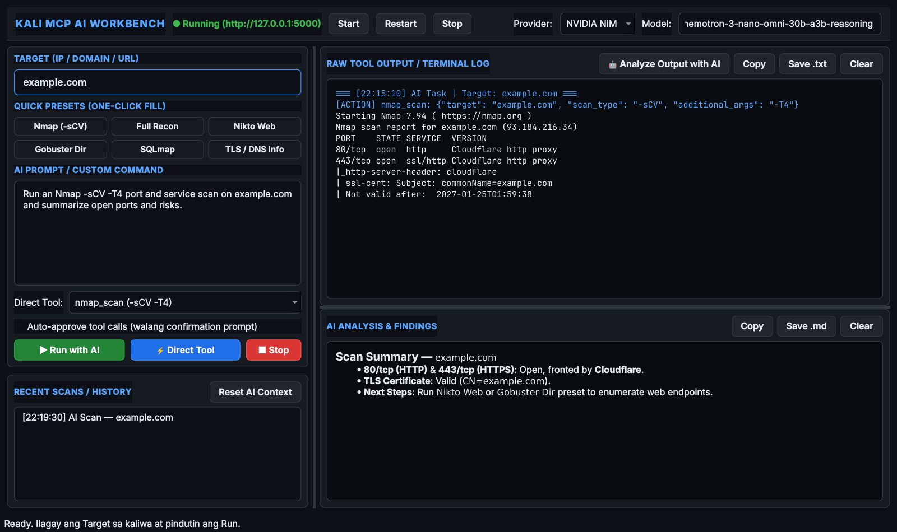

# 🐉 Kali MCP AI Workbench

> **AI-powered Offensive Security & Recon Assistant** para sa **Kali Linux** (`kali-server-mcp`) — may sariling **PySide6 Desktop GUI** (side-by-side layout) at **Interactive Terminal Agent** na gumagana sa **NVIDIA NIM** (Nemotron) at **OpenAI**.

<p align="left">
  
  
  
  
  <a href="https://github.com/willygailo/kali-mcp/graphs/contributors?from=2026-08-21T16%3A00%3A00.000Z">
    
  </a>
  <a href="https://github.com/willygailo/kali-mcp/commits/main">
    
  </a>
</p>

---

## 🖼️ Desktop GUI Preview

<p align="center">
  
</p>

---

## ✨ Mga Tampok (Features)

- **Side-by-Side Desktop GUI (`kali-gui.py`):**
  - **Kaliwang Pane (Controls):** Target input (`IP / Domain / URL`), 6 one-click scan presets (`Nmap (-sCV)`, `Full Recon`, `Nikto Web`, `Gobuster Dir`, `SQLmap`, `TLS / DNS Info`), custom AI prompt, Direct Tool runner, at clickable scan history.
  - **Kanang Pane (Instant Results):** Sabay na nakikita ang **Raw Tool Output / Terminal Log** sa itaas at **AI Analysis & Findings** sa ibaba — may `Analyze Output with AI`, `Copy`, at `Save .txt` / `Save .md`.
  - **Safe Execution:** Toggleable **Auto-approve** o inline **Approve / Decline** banner bago magpatakbo ng anumang tool.
- **Interactive Terminal Agent (`kali-agent.py`):** May `rich` markdown & panel formatting para sa headless o SSH workflows.
- **Dual Mode (AI + Direct):** Puwedeng magpa-analyze sa AI (`▶ Run with AI`) o direktang mag-execute ng Kali tool sa `kali-server-mcp` (`⚡ Direct Tool`) nang walang LLM roundtrip.
- **Auto `.env` Loading:** Ligtas na nakahiwalay ang API keys sa `.env` (gitignored) at awtomatikong nilo-load ng launchers at `kali_core.py`.

---

## 📁 Istruktura ng Proyekto

| File | Deskripsyon |
| :--- | :--- |
| `kali-gui.py` | PySide6 Desktop GUI (`KaliGuiWindow`) na may background worker threads at live status |
| `kali-agent.py` | Interactive at one-shot CLI AI assistant na gumagamit ng `rich` |
| `kali_core.py` | Shared core: `.env` loader, provider config, `TOOL_DEFINITIONS`, `call_kali_api`, at agent loop |
| `run-gui.sh` | One-command launcher para i-start ang `kali-server-mcp` at buksan ang Desktop GUI |
| `run-agent.sh` | One-command launcher para i-start ang `kali-server-mcp` at buksan ang Terminal Agent |
| `kali-mcp-manager.sh` | Control script para sa `/usr/bin/kali-server-mcp` (`start`, `stop`, `restart`, `status`) |
| `.env.example` | Template para sa API keys (`NVIDIA_API_KEY`, `OPENAI_API_KEY`) |
| `CONTRIBUTING.md` | Gabay at verification steps para sa mga magko-contribute |

---

## ⚙️ Setup & Installation

### 1. Kinakailangan (Prerequisites)
- Kali Linux na may naka-install na **`kali-server-mcp`** (`/usr/bin/kali-server-mcp`)
- Python 3 packages: `openai`, `requests`, `PySide6` (para sa GUI), at `rich` (opsyonal para sa CLI formatting)

```bash
pip install openai requests PySide6 rich
```

### 2. I-configure ang API Keys
Kopyahin ang `.env.example` bilang `.env` at ilagay ang iyong API key:

```bash
cp .env.example .env
```

```env
NVIDIA_API_KEY="nvapi-your-nvidia-api-key"
NVIDIA_BASE_URL="https://integrate.api.nvidia.com/v1"
NVIDIA_MODEL="nvidia/nemotron-3-nano-omni-30b-a3b-reasoning"

# Opsyonal fallback
OPENAI_API_KEY="sk-your-openai-api-key"
```

---

## 🚀 Paano Gamitin

### 🖥️ Desktop GUI (Recommended)
```bash
./run-gui.sh
```
1. Ilagay ang **Target** (IP, domain, o URL) sa kaliwang pane.
2. Pumili ng **Quick Preset** (o mag-type ng sariling prompt).
3. Pindutin ang **`▶ Run with AI`** para sa automated scan + analysis, o **`⚡ Direct Tool`** para sa direktang raw output.
4. Tingnan agad ang **Raw Tool Output** at **AI Analysis** sa kanang pane; i-save gamit ang `Save .txt` o `Save .md`.

### 💻 Terminal CLI Agent
- **Interactive chat (NVIDIA NIM default):**
  ```bash
  ./run-agent.sh
  ```
- **One-shot command:**
  ```bash
  ./run-agent.sh "Scan 127.0.0.1 for open ports with nmap"
  ```
- **Auto-approve tool calls (`-y` / `--yes`):**
  ```bash
  ./run-agent.sh -y "Check HTTP headers and open ports on 127.0.0.1"
  ```
- **Gamitin ang OpenAI provider:**
  ```bash
  ./run-agent.sh --provider openai --model gpt-4o
  ```

<details>
<summary>Lahat ng CLI Options ng <code>kali-agent.py</code></summary>

| Flag | Deskripsyon |
| :--- | :--- |
| `prompt` | Opsyonal na initial prompt para sa one-shot execution |
| `--provider {nvidia,openai}` | Piliin ang AI provider |
| `--model MODEL` | Override ng default model ID |
| `--api-key API_KEY` | Custom API key |
| `--base-url BASE_URL` | Custom OpenAI-compatible base URL |
| `--yes`, `-y` | Awtomatikong aprubahan ang tool calls nang walang prompt |

</details>

---

## 🛠️ Mga Available na Kali MCP Tools

| Tool | Endpoint | Gamit |
| :--- | :--- | :--- |
| `execute_command` | `/api/command` | Arbitrary Kali shell commands (`openssl`, `dig`, `curl`, atbp.) |
| `nmap_scan` | `/api/tools/nmap` | Network port & service discovery |
| `gobuster_scan` | `/api/tools/gobuster` | Directory, DNS, fuzz, at vhost enumeration |
| `nikto_scan` | `/api/tools/nikto` | Web server vulnerability scanning |
| `sqlmap_scan` | `/api/tools/sqlmap` | Automated SQL injection testing |
| `john_crack` | `/api/tools/john` | Password hash cracking (John the Ripper) |

---

## 🛑 Pag-manage ng Kali API Server

Tumatakbo ang `kali-server-mcp` sa `http://127.0.0.1:5000` (logs sa `/tmp/kali-server-mcp.log`):

```bash
./kali-mcp-manager.sh status   # I-check kung running at healthy
./kali-mcp-manager.sh start    # I-start ang background server
./kali-mcp-manager.sh restart  # I-restart ang server
./kali-mcp-manager.sh stop     # I-stop ang server
```

---

## 🔧 Troubleshooting

- **`kali-server-mcp` Offline:** Patakbuhin ang `./kali-mcp-manager.sh restart` at i-check ang `/tmp/kali-server-mcp.log`.
- **Missing API Key Error:** Siguraduhing may `.env` file sa root folder (tingnan ang `.env.example`) o naka-export ang `NVIDIA_API_KEY` / `OPENAI_API_KEY`.
- **Localhost Proxy Interference:** Awtomatikong naka-bypass sa `kali_core.py` (`http_session.trust_env = False`) at `NO_PROXY=localhost,127.0.0.1` sa launcher scripts.
- **IDE Import Warnings (`openai` / `PySide6`):** Ituro ang Python interpreter ng editor sa `/usr/bin/python3` kung saan naka-install ang system packages.

---

## 🗺️ Roadmap

- [ ] Custom wordlist picker at saved scan profiles sa GUI
- [ ] Export ng buong session report (Raw + AI Analysis) bilang single HTML/Markdown bundle
- [ ] Streaming token output habang nagre-reply ang AI

---

## 👥 Contributors

Salamat sa lahat ng tumulong at nag-ambag sa proyektong ito! Tingnan ang live contributions graph sa [GitHub Contributors](https://github.com/willygailo/kali-mcp/graphs/contributors?from=2026-08-21T16%3A00%3A00.000Z).

<table>
  <tr>
    <td align="center">
      <a href="https://github.com/willygailo">
        <br />
        <sub><b>willygailo</b></sub>
      </a><br />
      <sub>Creator &amp; Maintainer</sub>
    </td>
  </tr>
</table>

<a href="https://github.com/willygailo/kali-mcp/graphs/contributors?from=2026-08-21T16%3A00%3A00.000Z">
  
</a>

> Gusto mong mag-contribute? Basahin ang [CONTRIBUTING.md](CONTRIBUTING.md) at magbukas ng Pull Request!

---

## ⚠️ Paalala sa Responsableng Paggamit
Gamitin lamang ang tool na ito sa mga **awtorisadong penetration testing engagements, sariling lab/infrastructure, o CTF challenges**.
